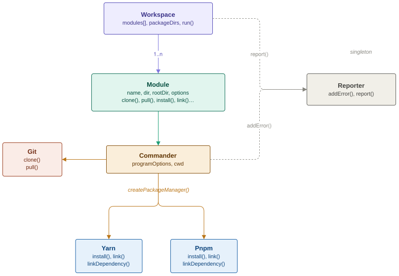

# kli

_kommand line interface_

**KLI** is a command-line tool for managing Git repositories and their Node.js dependencies as a workspace. Originally developed for [KDK](https://github.com/kalisio/kdk)-based applications, it can clone, update, install, link and unlink multiple repositories in a single command.

**KLI** supports **pnpm** for current projects and **Yarn Classic** for legacy projects. Each repository is managed using its own package manager.

## Concepts

A workspace is a JavaScript configuration file describing the repositories to manage and the local dependencies between them:

```js
module.exports = {
  'common-ekosystem': {
    branch: 'master',
    path: process.env.KALISIO_DEVELOPMENT_DIR
  },
  kdk: {
    branch: 'master',
    path: process.env.KALISIO_DEVELOPMENT_DIR,
    dependencies: ['@kalisio/common-core']
  },
  'example-api': {
    branch: 'main',
    devDependency: true,
    dependencies: ['@kalisio/kdk']
  },
  'example-app': {
    branch: 'main',
    application: true,
    dependencies: ['@kalisio/kdk']
  }
}
```

Each top-level key identifies a Git repository (module, monorepo or application). Supported properties are:

| Property | Description |
|---|---|
| `dependencies` | Package names to link locally when the corresponding targets are selected in the workspace. |
| `devDependency` | Exclude this entire module when **KLI** is run with `--production`. Defaults to `false`. |
| `branch` | Branch or tag to check out when cloning the repository. Takes precedence over the branch given to `--clone`. |
| `application` | Indicates that the repository also contains an `api/` project, which is installed separately. |
| `path` | Parent directory for the repository, relative to the current working directory or absolute. |
| `organization` | GitHub organization or GitLab group hosting the repository. |
| `output` | Local repository directory name (defaults to the workspace key). |
| `url` | Git server base URL (defaults to `https://github.com`). |
| `ignoreOptional` | For Yarn only: use `--ignore-optional` during installation (enabled by default). |
| `packages` | For monorepos: mapping of sub-package directories to their local `dependencies` (see below). |
| `prefix` | Prefix used when constructing qualified names for monorepo packages. |

> [!NOTE]
> `dependencies` and `devDependency` are **KLI workspace options**, not the `dependencies` and `devDependencies` fields in `package.json`. In particular, `devDependency: true` controls which *repositories* **KLI** processes; it does not pass `--prod` to the package manager.

### Monorepo support

**KLI** discovers sub-packages in a repository's `packages/` directory. For linking, their names are resolved as `@<organization>/<name>` or `@<organization>/<prefix>-<name>` if `prefix` is configured.

The `packages` property specifies the dependencies to link for individual sub-packages:

```js
module.exports = {
  'common-ekosystem': {
    branch: 'master',
    path: process.env.KALISIO_DEVELOPMENT_DIR
  },
  'feathers-ekosystem': {
    branch: 'master',
    path: process.env.KALISIO_DEVELOPMENT_DIR,
    packages: {
      'feathers-s3': {
        dependencies: ['@kalisio/common-core']
      },
      'feathers-import-export': {
        dependencies: ['@kalisio/common-core']
      }
    }
  }
}
```

KLI discovers the repositories and their packages **after cloning or pulling** and **before installing**. This makes it possible to prepare local links in a fresh workspace. Repository directories and their `package.json` files must exist before discovery; use `--clone` when setting up a new workspace.

### Package managers and local linking

KLI determines a repository's package manager from the `packageManager` field in its root `package.json`. Projects declaring pnpm use pnpm; otherwise KLI uses Yarn Classic. For applications, the `api/` project is inspected and installed separately.

**pnpm — generated hooks**

When `--install` is used, **KLI** resolves the configured local dependencies against the **selected** workspace modules and discovered monorepo packages. For pnpm repositories with links to apply, it generates a `.pnpmfile.cjs` before running `pnpm install`.

The hook rewrites matching dependency versions to relative `link:` paths. If a configured local dependency is absent from a consumer's `package.json`, the hook also injects it into the effective dependencies used for installation. It does not edit the source `package.json`.

For applications, **KLI** also generates the hook in `api/` so that the API installation can resolve its own local links. Generated `.pnpmfile.cjs` files belong to KLI: they can be overwritten or removed during workspace preparation and should be excluded from Git (for example with `.gitignore`).

When a hook is generated, **KLI** runs `pnpm install --lockfile=false`: the project's lockfile is neither read nor modified during that local installation.

> [!IMPORTANT]
> The local dependency injection is intended for workspace-specific development or test dependencies. Runtime dependencies should still be declared in the relevant `package.json` so the package remains independently installable. KLI warns when a configured link target is unavailable.

For pnpm projects, `--link` and `--unlink` do **not** perform manual linking: the local links are established during `--install` through the generated hook.

**Yarn Classic — legacy linking**

Yarn projects retain the historical `yarn link` / `yarn unlink` behavior. For these projects, run `--install --link` to install and then register/apply the configured links. `--link-folder` still selects a custom Yarn link directory.

**KLI** does **not** support local links between Yarn and pnpm projects. Legacy Yarn projects can consume **published** packages built with pnpm through the usual package registry.

### Production selection

Mark repositories required only for development or tests with `devDependency: true`. Pass `--production` to omit them from the selected workspace modules:

```bash
kli workspace.js --clone --install --production
```

This also removes the omitted repositories from the set of available local link targets. The flag selects repositories only; it does not alter the normal dependency-installation mode of Yarn or pnpm.

Use `--modules` to restrict execution to an explicit list of workspace entries. Only selected modules are discovered and considered as local link targets; links pointing to other modules are skipped with a warning.

## Installation

### Prerequisites

Install [Git](https://git-scm.com/book/en/v2/Getting-Started-Installing-Git), [Node.js](https://nodejs.org/en/download), and the package managers required by your workspace ([pnpm](https://pnpm.io/installation) and/or [Yarn Classic](https://classic.yarnpkg.com/lang/en/docs/install/)).

### Global installation

```bash
npm install -g @kalisio/kli
```

### Development installation

To work with the repository directly:

```bash
git clone https://github.com/kalisio/kli.git
cd kli
yarn install
yarn link
```

## Usage

By default, operations use the current working directory. The `path` and `output` properties let individual repositories use different locations.

```bash
# Prepare a workspace from scratch: clone, discover, generate pnpm hooks and install
kli workspace.js --clone --install

# Install repositories that already exist locally
kli workspace.js --install

# Install and apply historical Yarn links (pnpm linking still happens during install)
kli workspace.js --clone --install --link

# Remove historical Yarn links
kli workspace.js --unlink

# Process only specific repositories
kli workspace.js --modules common-ekosystem,kdk --install

# Exclude modules marked devDependency: true
kli workspace.js --clone --install --production
```

**KLI** processes the selected workspace in this order:

1. Clone and/or pull repositories, if requested.
2. Discover repository manifests and monorepo packages.
3. Generate pnpm hooks before any installation, when `--install` is requested.
4. Install each repository (and its `api/` project, if applicable).
5. Apply or remove legacy Yarn links when requested.

> [!IMPORTANT]
> `--install` without `--clone` expects all selected repository directories and their manifests to exist locally. Use `--fail-on-error` in CI to make command failures stop the job.

> [!NOTE]
> Git operations default to the `kalisio` organization. Use `--organization` to change it globally or the `organization` property on individual modules. Sample workspaces are available in this repository.

### CLI options

```text
Usage: kli <workspacefile> [options]

Options:
  -V, --version                  Show the version
  -o, --organization <org>       GitHub organization or GitLab group (default: kalisio)
  -u, --url <url>                Git server base URL (default: https://github.com)
  -c, --clone [branch]           Clone repositories (branch used for modules without a branch)
  --shallow-clone                Perform shallow clones
  -p, --pull                     Pull repositories
  -i, --install                  Install dependencies
  --check-files                  Check files during Yarn installation
  -l, --link                     Link packages (Yarn only)
  --link-folder <folder>         Directory for Yarn links
  -ul, --unlink                  Unlink packages (Yarn only)
  -m, --modules <list>           Comma-separated list of modules
  --production                   Exclude modules marked devDependency: true
  --command-output               Show command output
  --fail-on-error                Exit on command error
  -h, --help                     Show help
```

## Tips

### Working on multiple versions

Yarn Classic links can depend on the Yarn installation associated with a Node.js version. Keep separate workspaces for different application versions, and unlink an old Yarn workspace before linking a different one:

```bash
# Leave a legacy Yarn workspace
kli workspace-old.js --unlink

# Switch to another Node.js version and workspace
nvm use 24
kli workspace-new.js --install --link
```

pnpm projects do not use this global Yarn link mechanism: their local links are generated for each workspace when installing.

### Aliasing KLI

When working from a **KLI** source checkout, you can define an alias in `.bashrc`:

```bash
alias kli="node /path/to/kli/bin.js"
```

## Contributing

### Guidelines

Found a bug, missing feature or opportunity to contribute? See the [contribution guidelines](./docs/CONTRIBUTING.md).

### Object model

**KLI** is structured around three main layers:

- `Workspace` selects modules and orchestrates cloning, discovery, pnpm hook generation, installation and linking.
- `Module` represents a repository and owns its paths, Git operations, package discovery and dependency configuration. It delegates installations and legacy linking to the appropriate package manager.
- `Commander` executes shell commands in a fixed working directory. `Git` and the `Yarn` / `Pnpm` implementations use it to run their commands.

`Reporter` collects command errors for the final report, and `Logger` provides contextual console output.

<div align="center">
  
</div>

### Debugging

Enable verbose **KLI** diagnostics with:

```bash
DEBUG=kli kli workspace.js --install
```

## License

Licensed under the [MIT license](LICENSE).

Copyright (c) 2017-present [Kalisio](https://kalisio.com)

<picture>
  <source media="(prefers-color-scheme: dark)" srcset="https://kalisio.github.io/kalisioscope/kalisio/kalisio-logo-dark.svg">
  <source media="(prefers-color-scheme: light)" srcset="https://kalisio.github.io/kalisioscope/kalisio/kalisio-logo-light.svg">
  
</picture>